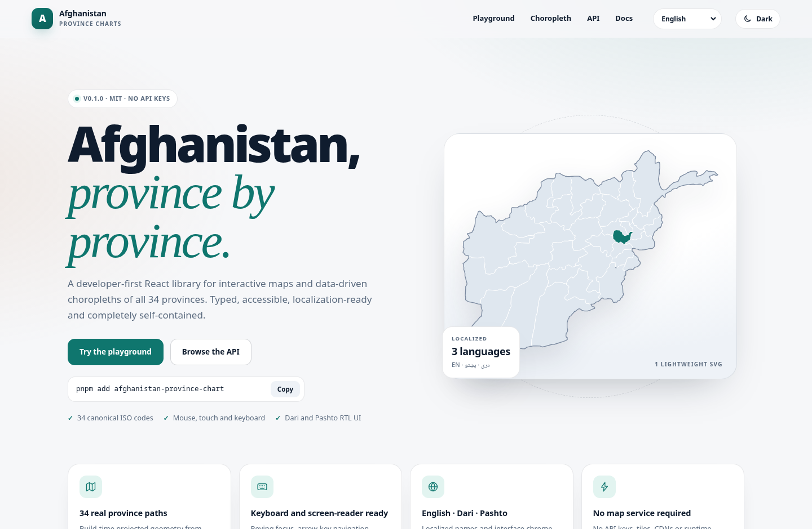

# Afghanistan Province Charts

**Interactive, accessible React maps and choropleths for the 34 provinces of Afghanistan.**

[](#compatibility)
[](#typescript)
[](./LICENSE)



> **Status:** `0.1.0-beta.0` has not been published to npm yet. The public API
> and visual design have been reviewed. See [Release readiness](#release-readiness).

`@afghan-province-charts/react` renders the country as a responsive SVG. No API keys, map
tiles, CDNs, external services or runtime network requests are involved. The
package ships pre-projected geometry, a typed province registry, a data-driven
choropleth and a two-stop color legend.

## Highlights

- **All 34 provinces**, keyed by canonical ISO 3166-2:AF codes.
- **Interactive:** mouse, touch, keyboard focus, arrow-key navigation, Enter and
  Space activation, controlled and uncontrolled selection.
- **Accessible:** visible focus rings, live announcements, accessible names that
  include metric values, non-color selection affordances and reduced-motion
  support.
- **Localized:** English, Dari (`prs`) and Pashto (`ps`), including RTL tooltips
  and legends. Map geometry is never mirrored.
- **Data-driven:** partial datasets are supported; missing values are distinct
  from zero; negative numbers, fixed domains and custom formatters work.
- **Themable:** scoped CSS variables, per-prop color overrides and automatic
  light/dark defaults.
- **Typed:** strict TypeScript declarations, no `any` in the public API.
- **SSR-safe:** no browser globals at module initialization; verified with
  `renderToString` and hydration tests.
- **Lightweight:** D3 is build-time only. Geometry is serialized into the bundle
  as SVG paths. Measured at `0.1.0-beta.0`: `dist/index.js` is about 94 kB raw
  and **32.0 kB gzip**, including all 34 province paths; the stylesheet is
  **1.8 kB gzip**.

## Quick start

```bash
pnpm add @afghan-province-charts/react
```

```tsx
import { AfghanistanMap } from "@afghan-province-charts/react";
import "@afghan-province-charts/react/styles.css";

export default function Dashboard() {
  return (
    <AfghanistanMap
      locale="en"
      height={480}
      onProvinceClick={({ province }) => {
        console.log(province.code);
      }}
    />
  );
}
```

The map fills its container, keeps its real aspect ratio and works inside cards,
grids, side panels and full-page layouts.

## Choropleth

```tsx
import { AfghanistanChoropleth } from "@afghan-province-charts/react";
import "@afghan-province-charts/react/styles.css";

const reach = {
  "AF-KAB": 96,
  "AF-HER": 72,
  "AF-BAL": 68,
  "AF-KAN": 64,
  // Missing provinces render with the missing-data color — never as zero.
};

export function Report() {
  return (
    <AfghanistanChoropleth
      data={reach}
      locale="en"
      showLegend
      showTooltip
      legendTitle="Service reach (illustrative)"
    />
  );
}
```

## Controlled selection

```tsx
import { useState } from "react";
import { AfghanistanMap, type ProvinceCode } from "@afghan-province-charts/react";

export function ProvincePicker() {
  const [selected, setSelected] = useState<ProvinceCode | null>(null);

  return <AfghanistanMap selectedProvince={selected} onSelectionChange={setSelected} />;
}
```

Clicking the selected province deselects it. In controlled mode the parent owns
the state; `onSelectionChange(null)` signals deselection.

## Localization

```tsx
<AfghanistanMap locale="prs" />  // Dari
<AfghanistanMap locale="ps" />   // Pashto
```

Province names, tooltips, legends and accessible labels switch at runtime.
RTL applies to interface chrome; the physical map is never flipped.

## Custom styling

Pass color tokens as props:

```tsx
<AfghanistanMap
  colors={{
    fill: "#e6edf5",
    hoverFill: "#cfe0ee",
    selectedFill: "#0f766e",
    border: "#ffffff",
    focus: "#0f766e",
  }}
/>
```

Or override the scoped variables:

```css
.my-map {
  --af-map-fill: #e8edf2;
  --af-map-hover-fill: #cfe0ee;
  --af-map-selected-fill: #0f766e;
  --af-map-border: #ffffff;
  --af-map-tooltip-bg: #0f172a;
  --af-map-tooltip-text: #f8fafc;
  --af-map-focus: #0f766e;
  --af-map-transition: 140ms ease;
}
```

See [docs/customization.md](./docs/customization.md) for the full token list.
For a walkthrough of each component, see
[docs/interactive-map.md](./docs/interactive-map.md) and
[docs/choropleth.md](./docs/choropleth.md).

## Compatibility

| Environment        | Status                                                                        |
| ------------------ | ----------------------------------------------------------------------------- |
| React 18           | Supported (peer dependency `^18.0.0`)                                         |
| React 19           | Supported (peer dependency `^19.0.0`)                                         |
| Vite               | Supported                                                                     |
| Next.js App Router | Supported; add `"use client"` when passing callbacks or controlling selection |
| Server rendering   | Supported; no browser globals at module load                                  |
| Browsers           | Current evergreen browsers with SVG and CSS custom-property support           |

The package is ESM-only, ships TypeScript declarations and does not bundle React.

## Public exports

Components:

- `AfghanistanMap`
- `AfghanistanChoropleth`
- `MapLegend`

Utilities:

- `getProvinces()`
- `getProvinceByCode(code)`
- `getProvinceName(code, locale)`
- `isProvinceCode(value)`
- `getLocaleDirection(locale)`
- `SUPPORTED_LOCALES`, `DEFAULT_LOCALE`, `INTL_LOCALES`

Types include `ProvinceCode`, `Province`, `Locale`, `MapColors`,
`AfghanistanMapProps`, `AfghanistanChoroplethProps`, `ProvinceNumericData`,
`ProvinceInteraction` and `ProvinceTooltipContext`.

Full API: [docs/api-reference.md](./docs/api-reference.md).

## The playground

The playground in `apps/playground` is the public demo and doubles as the
documentation site.

```bash
pnpm install
pnpm dev
```

`pnpm dev` builds the library and starts the Vite playground at
<http://localhost:5173>. To produce the static site:

```bash
pnpm build
pnpm --filter @afghan-province-charts/playground preview
```

Screenshots in this README are captured from that running playground by the
Playwright suite, not mocked up.

## Geographic data and licensing

- Boundary source: **geoBoundaries gbOpen, Afghanistan ADM1**, boundary year
  **2007**, 34 units, dataset listed as **public domain**.
- geoBoundaries project code and derivative works are CC BY 4.0; attribution is
  required. Cite geoBoundaries (<https://www.geoboundaries.org>).
- Source codes `AF_BDN` and `AF_KAN` are normalised to ISO 3166-2:AF (`AF-BDS`,
  `AF-KAN`). Source spellings `Ghanzi` and `Nimruz` are exposed as `Ghazni` and
  `Nimroz`.
- The dataset is a generalised cartographic source from 2007, not a legal,
  cadastral or survey-grade boundary.
- No runtime downloads occur. Source file, checksum, reviewed mapping and
  generation scripts are committed.

Read [DATA_LICENSE.md](./DATA_LICENSE.md) and
[docs/data-and-licensing.md](./docs/data-and-licensing.md).

## Development

```bash
pnpm install
pnpm typecheck     # strict TypeScript across packages
pnpm lint          # ESLint
pnpm test          # Vitest + React Testing Library
pnpm data:validate # geometry, registry and provenance checks
pnpm data:geometry # regenerate geometry from the preserved source
pnpm build         # library + playground
pnpm test:e2e      # Playwright (install browsers first)
pnpm package:check # publint + Are The Types Wrong
pnpm verify:package # pack, install in isolated React apps and build
```

Regenerating geometry rewrites `packages/react/src/data/geometry.ts`. Review the
diff before committing. Never edit that file by hand.

## Release readiness

The npm package has not been published yet. Before `npm publish`:

- [x] 34 provinces render with canonical ISO identifiers.
- [x] Pointer, touch and keyboard interaction tests pass.
- [x] Localization and RTL chrome verified.
- [x] Choropleth missing/zero/negative behavior tested.
- [x] Unit, component, SSR, hydration, accessibility and Playwright tests pass.
- [x] Geographic provenance and checksums validated.
- [x] Package exports, declarations and packed tarball inspected.
- [x] Public API and visual design reviewed by the maintainer.
- [x] Package repository URL points to this GitHub repository.
- [ ] Confirm npm scope ownership for `@afghan-province-charts`.
- [ ] Publish `0.1.0-beta.0` when the maintainer is ready.

## Contributing

Issues and pull requests are welcome. Please read
[docs/contributing.md](./docs/contributing.md) first. Province name corrections
with a reliable source are especially valuable.

## License

Original source code: [MIT](./LICENSE). Geographic data: public domain per the
source metadata, with geoBoundaries attribution required. See
[DATA_LICENSE.md](./DATA_LICENSE.md).
